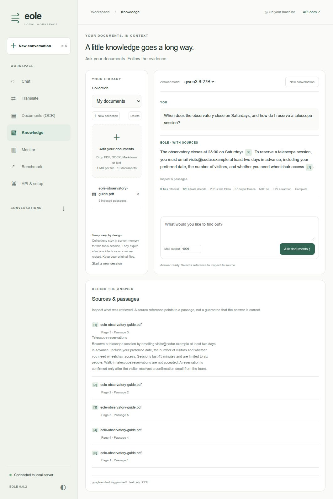

# Local Knowledge workspace (RAG)

Import documents, ask questions, and inspect the passages used by the answer.


This recipe develops the retrieve-then-generate idea from [PR #159](https://github.com/eole-nlp/eole/pull/159)
using the bundled Eole UI.

The retrieval stack uses LangChain's PDF loader and tokenizer-aware text splitter,
its Chroma integration, and **google/embeddinggemma-2** through Sentence Transformers.
EmbeddingGemma runs text-only on **CPU in FP32**, with vision/audio encoders disabled.
Its eager attention avoids interference from Eole's global CUDA SDPA backend settings.
Qwen3.8-27B-INT4 generates answers on the GPU through Eole, using configured MTP
when eligible. No external LLM API, LangGraph agent, or cloud vector database is used.

## Install and start

EmbeddingGemma 2 requires recent Transformers and Sentence Transformers releases.
To preserve another environment (especially one containing vLLM with an older
Transformers requirement), use a separate virtual environment. This example reuses
an existing working Eole/PyTorch installation and installs only the RAG dependencies:

```bash
python -m venv --system-site-packages /path/to/eole-rag-env
source /path/to/eole-rag-env/bin/activate
pip install -r recipes/rag/requirements.txt

export EOLE_MODEL_DIR=/path/to/models
export QWEN38_MODEL="$EOLE_MODEL_DIR/Qwen3.8-27B-INT4"
CUDA_VISIBLE_DEVICES=0 OMP_NUM_THREADS=8 \
  EOLE_TORCH_COMPILE=1 EOLE_COMPILE_MODE=0 \
  python -m eole.bin.main serve -c recipes/rag/serve.yaml \
  --host 127.0.0.1 --port 5000
```

Run from the repository root. This does not rebuild the CUDA extension. For a
fresh Eole installation, the same libraries are available through `pip install 'eole[rag]'`.
The combined `recipes/ui/serve-showcase.yaml` also includes Knowledge.

Open **http://127.0.0.1:5000**, select **Knowledge**, and import
[observatory-guide.md](observatory-guide.md). It is an explicitly fictional sample.
Try: **“When does the observatory close on Saturdays and how can I reserve a telescope?”**
The answer should mention **23:00** and emailing **visits@cedar.example** at least
**two days in advance**, with supporting source references.

The first import downloads/caches the embedding model weights if absent. The first
Qwen answer can spend minutes compiling; subsequent requests reuse compiled programs.
`OMP_NUM_THREADS=8` is a starting point for CPU embedding throughput; adjust for your machine.

## Workflow

- Create/select a collection, then drop or select PDF, DOCX, Markdown or text files.
- Ask a question. Retrieval selects up to five passages before generation.
- Click a `[1]` reference to inspect its passage and PDF page number, or inspect the
  sources attached to an earlier answer. DOCX and text sources have passage numbers,
  since they do not have reliable fixed page boundaries.
- Ask follow-ups in the same collection. The previous user question is included in
  the retrieval query; this initial version does not run a separate query-rewriting LLM.
- Remove documents or delete collections when finished. New conversation clears
  questions and answers while retaining the indexed collection.
- For scanned PDFs, use Documents (OCR), download the extracted Markdown, and import
  it here. This version indexes text, not page images, audio, or video.

Limits: 4 MB/file, 50 PDF pages, 80,000 extracted characters/document,
10 documents/collection, four collections/session, and 16 active sessions/server.
Encrypted PDFs must be unlocked first. Generation keeps only passages that fit the
selected model's context budget and rejects requests if no passage fits.

## Storage and privacy

Collections, vectors and extracted text are temporary server-memory data. A random
session token kept in this tab's `sessionStorage` separates collections from other
sessions. Sessions expire logically after one idle hour; their data is reclaimed on
the next collection operation, or on server shutdown. A server restart removes all
collections. Resetting a session explicitly removes its previous collections.
Answers live in the tab's memory and are cleared on reload. The model weights remain
in the normal Hugging Face cache. PDF parsing uses a temporary file removed after loading.
Chroma persistence and anonymized telemetry are disabled.

Session tokens provide collection isolation, **not user authentication**. Use an
access-controlled reverse proxy if sharing the server. As with the other workspace
views, active/recent request metrics are server-wide; document text and collection
contents are not included in those metrics.

## Configuration and measurements

```yaml
knowledge:
  embedding_model: google/embeddinggemma-2  # also accepts its local model directory
  chunk_tokens: 384
  chunk_overlap: 48
  retrieval_k: 5
```

The backend supplies distinct question/document embedding prompts and normalized
768-dimensional vectors. The configurable model location is intended for
EmbeddingGemma 2-compatible checkpoints; it is not a generic embedding adapter.
Generation uses the selected Eole chat model. A Knowledge model default can be set
through `workspace.models.knowledge`.

Indexing time includes embedding-model initialization when needed. Retrieval time
includes CPU queueing, query embedding and vector search. Decode tokens/second comes from Eole's
inference worker; it excludes retrieval, prefill and compilation. Source references
identify retrieved evidence, but do not independently verify the generated claims.

Tests without downloads run with:

```bash
python -m unittest eole.tests.test_ui_knowledge
```

PDF extraction tests run when the optional RAG packages and PyMuPDF are installed.

For an opt-in real embedding/Chroma test (loads or downloads model weights):

```bash
OMP_NUM_THREADS=8 EOLE_TEST_RAG_MODEL=google/embeddinggemma-2 \
  python -m unittest eole.tests.test_knowledge_embedding
```
