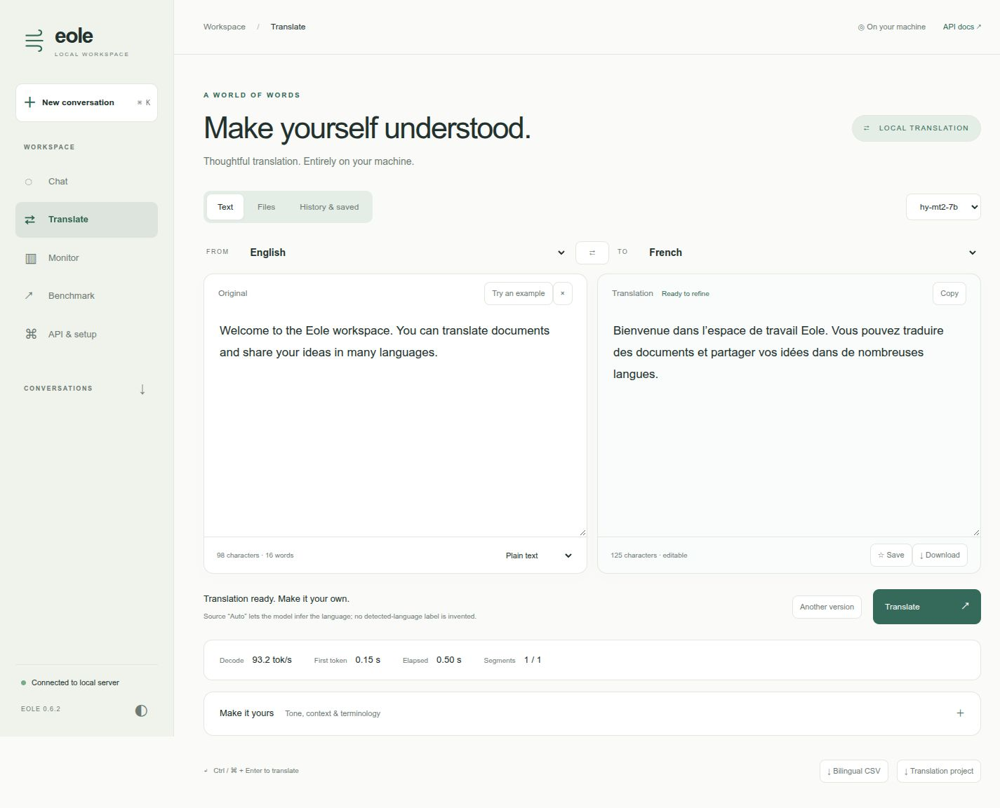
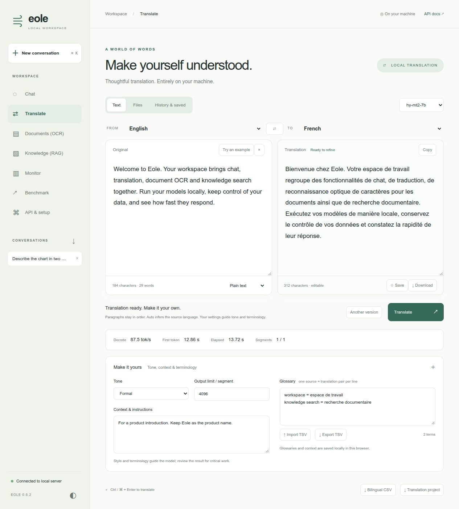

# Translate in the Eole workspace

A dedicated translation view shares Eole's local workspace, model server,
monitoring and theme. It is separate from conversational chat: there is no chat
history or system persona in the translation prompt.



The [workspace video tour](../ui/images/showcase.mp4) includes Hy-MT2 translation
and its terminology controls, alongside Qwen visual chat and benchmarking,
Documents (OCR), and Knowledge (RAG). All visuals show the full workspace menu.

## Showcase: Hy-MT2-7B

Use an Eole checkpoint of [tencent/Hy-MT2-7B](https://huggingface.co/tencent/Hy-MT2-7B).
This is a BF16 model, not the INT4 Qwen chat checkpoint. With Eole 0.6.4 or newer,
choose either preparation option below. Both use the same local model path:

```bash
export EOLE_MODEL_DIR=/path/to/models
export HY_MT2_MODEL="$EOLE_MODEL_DIR/Hy-MT2-7B"
```

**Download pre-converted weights:** the public
[Eole Hy-MT2 package](https://huggingface.co/eole-nlp/Hy-MT2-7B-eole) includes its
configuration and tokenizer. No conversion or HF token is required:

```bash
hf download eole-nlp/Hy-MT2-7B-eole --local-dir "$HY_MT2_MODEL"
```

**Or convert the original HF checkpoint:** pass the upstream repository ID or
an existing local HF directory:

```bash
eole convert HF --model_dir tencent/Hy-MT2-7B \
  --output "$HY_MT2_MODEL" --dtype bf16
```

Use a new destination for either option; skip preparation if you already have an
Eole checkpoint. To pin a pre-converted download, add `--revision COMMIT_SHA`;
validated pins are in the [RunPod model catalog](../runpod/models.json).
Runtime dependencies and GPU memory requirements are the same for both options.
Then start the server:

```bash
CUDA_VISIBLE_DEVICES=0 EOLE_TORCH_COMPILE=1 EOLE_COMPILE_MODE=0 \
  eole serve -c recipes/translation/serve.yaml --host 127.0.0.1 --port 5000
```

Open **http://127.0.0.1:5000**. The recipe selects Translate on startup, a
16,384-token context, 4,096 output tokens per segment, FlashAttention and packed
projections. It was tested on one RTX 5090. Cold compilation is included in the
first-token latency, so the first request can take longer.

The default uses greedy decoding for repeatable terminology comparisons.
**Another version** samples with temperature 0.7, top-k 20 and top-p 0.6, following
the model card's sampling values. Eole has no matching repetition-penalty setting;
this is not an exact reproduction of Tencent's complete generation configuration.
MTP is off. FP32 normalization is unchanged.

## Everyday workflows

- **Text:** choose source and target languages, paste text, translate, edit the
  result, copy it or download it. Ctrl/Cmd + Enter translates. Source **Auto** asks
  the model to infer the language; it does not claim a separate language detector.
  Choose an explicit source language before swapping the pair and back-translating.
- **Style and terminology:** expand **Make it yours** to add formal/informal tone,
  background context and glossary pairs. Use `source = translation` or tab-separated
  pairs, one per line, up to 100. TSV import/export has no header row. These settings
  guide generation rather than guaranteeing constrained decoding.
- **Files:** import up to eight UTF-8 TXT, Markdown, SRT, WebVTT or JSON files.
  Select a file to review/translate it, or use **Translate all files**. Jobs run
  sequentially with visible segment progress; they do not spawn an unbounded
  inference request per paragraph. Each file has its own result and download.
- **Documents:** DOCX and text-based PDF imports extract text on the local server.
  Downloads are translated TXT, not rebuilt DOCX/PDF. Tables become paragraph text;
  layout, styling, images, footnotes and reading order are not guaranteed. Scanned
  PDFs require OCR first. Import limits are 4 MB, 50 PDF pages, and 80,000 extracted
  characters. DOCX import is built in. PDF import additionally requires:

  ```bash
  pip install 'eole[translation]'
  # or: pip install pypdf
  ```

- **History and phrasebook:** complete translations are stored in this browser,
  searchable by text/language. Star useful translations, reopen them, or export
  history as JSON. There is no cloud account or cross-device synchronization.
- **Review/export:** results remain editable. Download translated text/files,
  bilingual CSV, or a JSON project containing the source, result, settings, segment
  pairs and measurements. Edits are included in the full result; original generated
  segment pairs and timing measurements remain available in the project.



## Structure, long texts and incomplete jobs

Text is segmented at paragraph breaks, preserving leading/trailing whitespace and
blank-line order. Long paragraphs are split on word boundaries, or CJK punctuation/character boundaries. Markdown uses
model instructions to preserve formatting; fenced code and Markdown structure
are not parsed or guaranteed byte-for-byte.

JSON is parsed before translation. Only nonempty string **values** are submitted;
keys, numbers, booleans, nesting and surrounding formatting remain outside model
generation. Exported values are JSON-escaped. This does not distinguish user-facing
strings from machine identifiers: review which values are appropriate to translate.

SRT/WebVTT cue identifiers, timestamps, settings and non-cue blocks remain outside
model generation. Cue text is translated separately. Changed subtitle line counts,
inline tags or common placeholders (`{{name}}`, `${name}`, `%s`) cause a visible
error rather than a silently damaged file. This is not a subtitle re-timing tool.

There is a limit of 200 segments and 80,000 input characters per job. Individual
prompts are checked against model context and output limits. Cancellation is
cooperative; it waits for the current forward/compilation, or the current complete
segment on native encoder-decoder models. Disconnects drain the inference worker
before another workspace job can acquire it.

An output-limit stop is labelled **incomplete**. Completed segments remain available;
untranslated segments stay in the reconstructed document. Partial jobs are not
added to complete history automatically. They can still be explicitly exported
for review. Increase the output budget or split the input before retrying.

## Other models and native encoder-decoder translation

Instruction models use a single user message and their own chat template. The
prompt follows Tencent's [documented terminology/context/style examples](https://huggingface.co/tencent/Hy-MT2-7B).
Language names must be full names. The default list matches Hy-MT2's 38 documented
languages; configure a different list for other models.

Native encoder-decoder models receive **raw source text**, without a chat template.
Specify their fixed language direction in the server model entry:

```yaml
translation:
  prompt_style: raw
  source_language: English
  target_language: French
  languages: [English, French]
```

Their existing tokenizer transforms and language-token/prefix configuration must
already be correct for that direction. The UI locks the language pair and disables
prompt-based glossary, tone and context controls. No automatic NLLB language-token
insertion is attempted. Use `prompt_style: instruction` for Hy-MT2 and other
instruction translation models.

Chat and Translate share one workspace scheduling lock, Stop endpoint and recent
metrics. API endpoints remain available. Native encoder-decoder output appears
one segment at a time; exact generated token counts/decode speed are omitted when
that inference path does not expose them. Translation metrics aggregate decoder
worker timings across segments and show whole-job elapsed time separately.

## Design references and boundaries

The workflow borrows useful patterns from [DeepL's glossary, style and file tools](https://support.deepl.com/hc/en-us/categories/360002992680-Features)
and [Google Translate's history and saved translations](https://support.google.com/translate/answer/6142480?hl=en-GB).
It does not call those services or send text to them. There is no camera, speech,
website crawling, OCR or document-layout translation service in this view.
Review translations and model-dependent terminology before publishing.

`apps/eole-translator.py` remains available as a legacy Gradio example. Its old
paragraph splitting could rearrange leading/blank separators and used one thread
per paragraph; the bundled workflow replaces those mechanics without deleting the
example in this PR.
