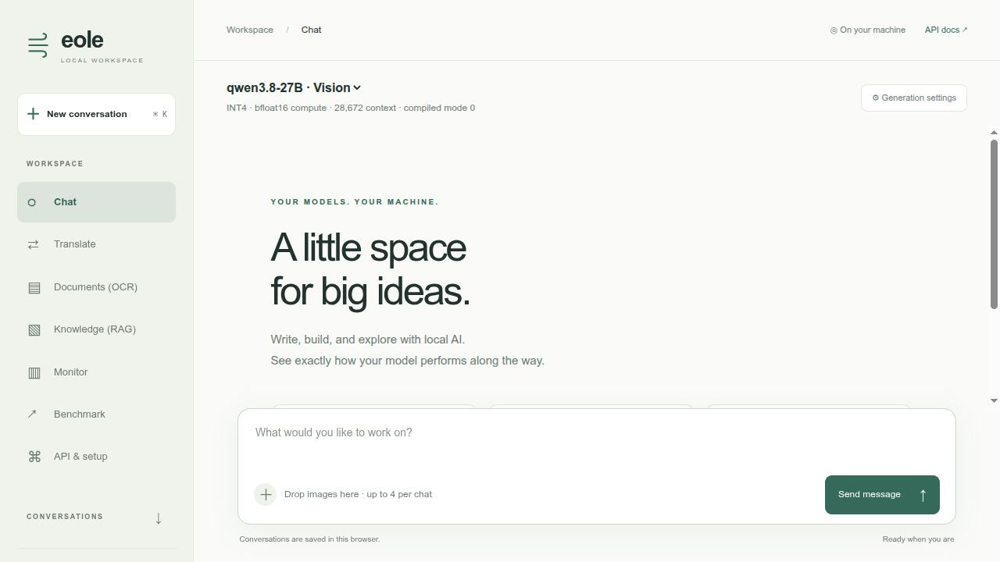
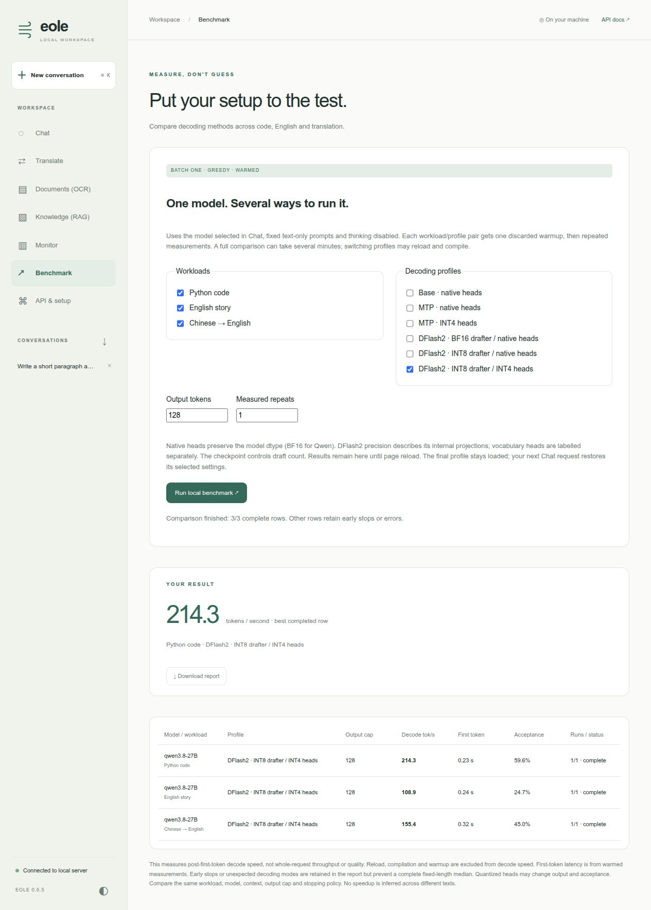
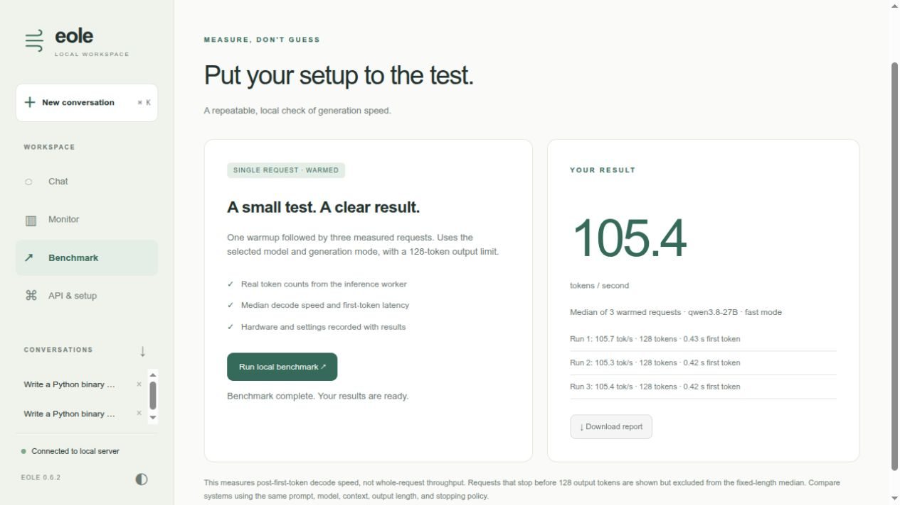
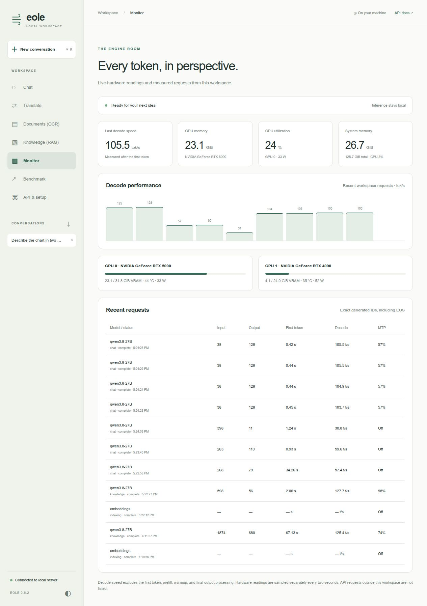
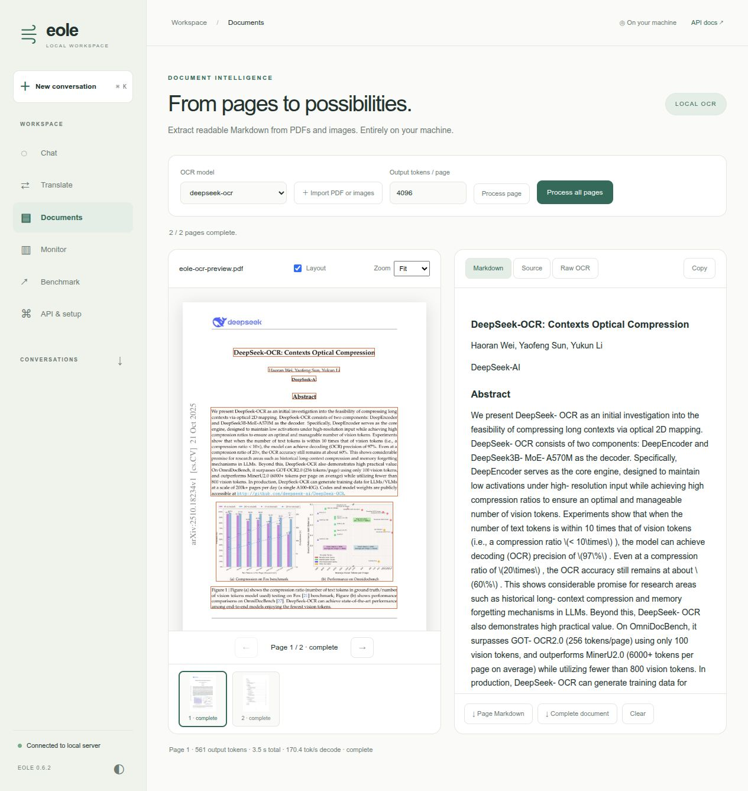
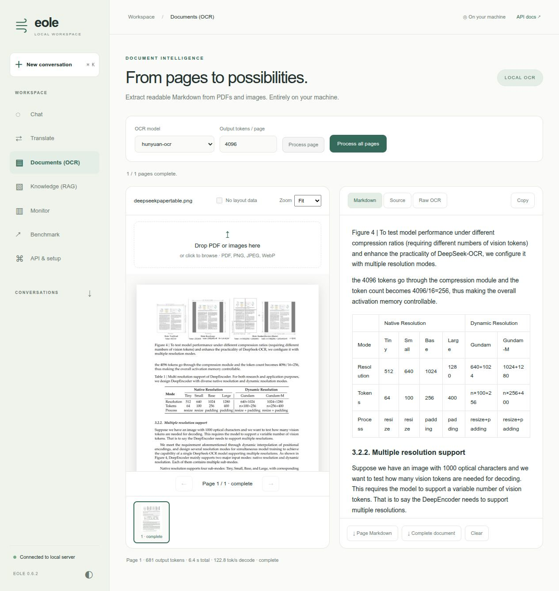
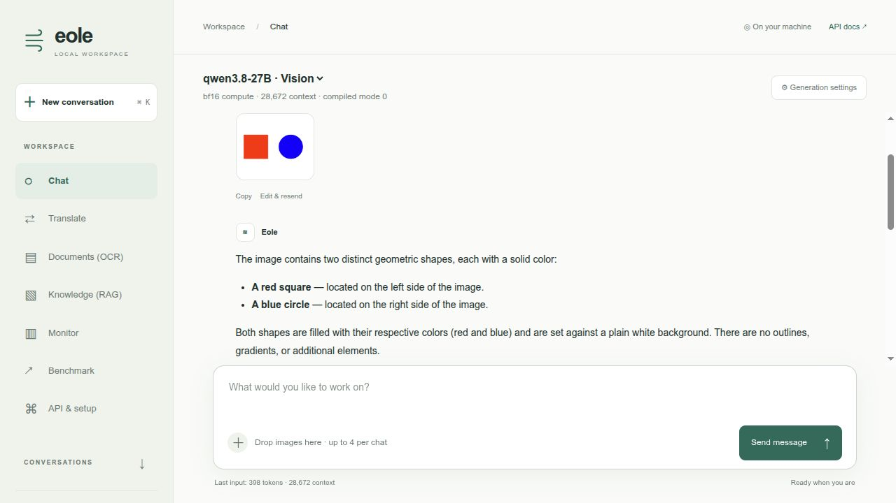
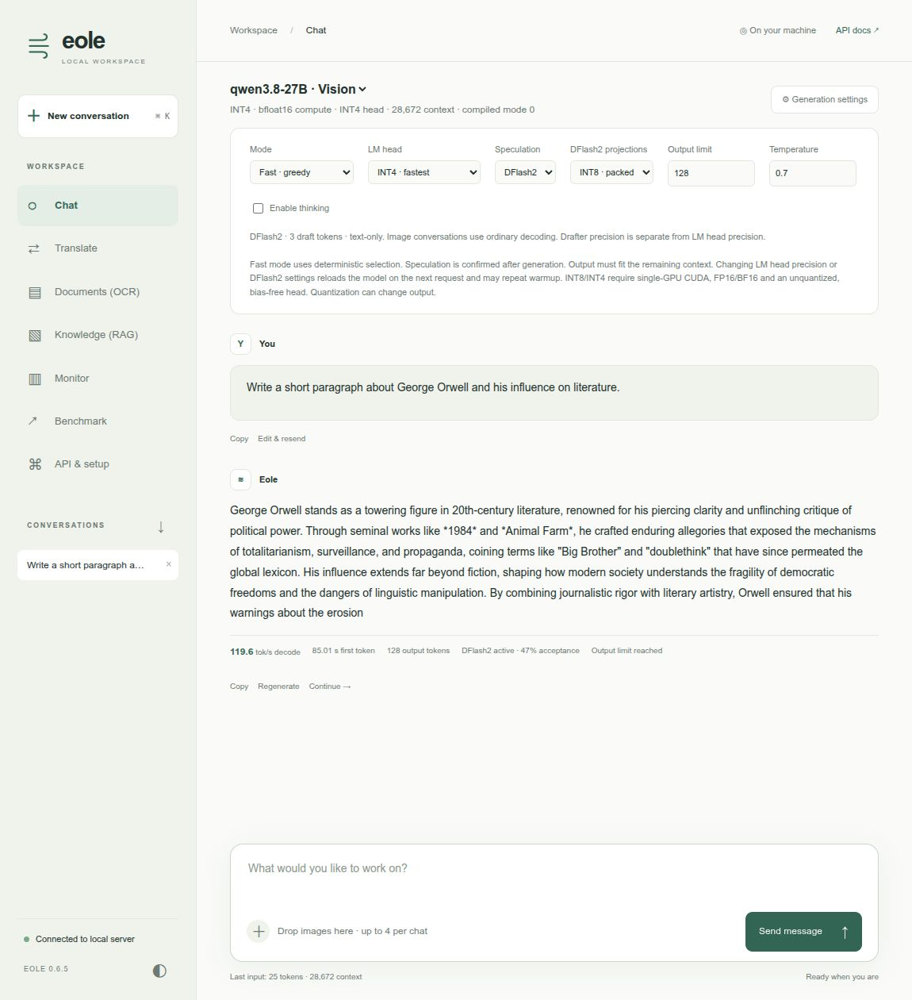

# Eole local workspace

`eole serve` now includes a browser interface at `/`. No Gradio, Node runtime,
frontend build, external fonts, or CDN is required. API routes and `/docs`
remain available. The original `apps/chatbot.py` stays a small Gradio example.

For all four workspaces on your own GPU, follow the
[combined local quick start](#combined-showcase-chat-translate-documents-ocr-and-knowledge-rag).



[Watch the 39-second UI tour](images/showcase.mp4). This edited tour shows real local
Qwen visual chat and benchmark results, Hy-MT2 translation, DeepSeek-OCR page
extraction, and Knowledge (RAG) with cited PDF passages and the embedding CPU toggle.
Every view shows the complete left-hand workspace menu. Model loading and compilation
waits are omitted; the displayed measurements come from the inference worker on
an RTX 5090. OCR captures use the dedicated eager OCR recipe. The animated
preview is on the repository front page.

## Start with Qwen3.8 INT4

Use the converted **RedHatAI/Qwen3.8-27B-INT4** checkpoint, including MTP weights.
See [the Qwen3.8 recipe](../qwen38/README.md#hardware-and-checkpoint) for runtime
installation and either direct Eole checkpoint download or HF conversion.
Run from the repository root:

```bash
export EOLE_MODEL_DIR=/path/to/models
export QWEN38_MODEL="$EOLE_MODEL_DIR/Qwen3.8-27B-INT4"
# Skip this download if QWEN38_MODEL already contains your Eole checkpoint.
hf download eole-nlp/Qwen3.8-27B-INT4-eole --local-dir "$QWEN38_MODEL"
CUDA_VISIBLE_DEVICES=0 EOLE_TORCH_COMPILE=1 EOLE_COMPILE_MODE=0 \
  eole serve -c recipes/ui/serve.yaml --host 127.0.0.1 --port 5000
```

Open **http://127.0.0.1:5000**. The supplied config uses BF16 compute,
Marlin projection packing, three MTP drafts, a 28,672-token context, and
chunked prefill. Context and output limits should be adjusted for your GPU;
this recipe is intended for an RTX 5090 with the converted INT4 model.
The chat output limit defaults to 16,384 tokens, capped by the selected model's
limit and remaining context budget. The Qwen workspace templates allow 16,384
output tokens, including the RunPod-generated showcase.
It does not alter FP32 normalization.

The first compiled request can spend several minutes warming all full and
shortened verifier shapes. The UI shows preparation and reports warmup
separately. Subsequent requests reuse the compiled programs. Stop is cooperative:
it takes effect after the current forward or compilation finishes.

For optional GPU/CPU/RAM telemetry, install:

```bash
pip install nvidia-ml-py psutil
```

Alternatively install Eole with the `ui` extra. Missing drivers or optional
packages display unavailable readings; they do not prevent chat.

For a dedicated translation workflow, including Hy-MT2-7B, see the
[translation workspace recipe](../translation/README.md). Chat and Translate share
the same interface, monitoring and local server.

## Workspace features

- **Knowledge:** local document collections, EmbeddingGemma 2 retrieval (GPU by default, with a CPU toggle) through LangChain and Chroma,
  streamed Qwen answers, clickable source references and separate retrieval/generation metrics.
  See the [RAG recipe](../rag/README.md) for optional dependencies and a sample document.

- **Chat:** streaming responses, browser-local conversation history, edit/resend,
  regenerate, continuation after an output limit, basic Markdown/code rendering,
  copy/export, text-file and image attachments, separate thinking, and light/dark themes.
  Vision models support image previews, drag-and-drop, paste, and visual follow-up questions.
- **Generation settings:** Fast uses greedy selection and configured MTP when
  eligible. Creative uses sampling and turns MTP off. The response footer shows
  actual MTP activity and acceptance, not just the configured option.
- **Monitor:** cached hardware readings, active workspace requests, recent
  request timings, and a decode-speed chart. It tracks this UI's requests;
  external API requests are not listed. GPU cards are physical NVML devices.
- **Benchmark:** compare code, English prose and Chinese-to-English translation
  across base, MTP and DFlash2 profiles. Select workloads/profiles, an output cap
  (default 512) and 1–5 measured repeats (default 3). Each pair starts with one
  discarded warmup. Results accumulate in a table until page reload and can be
  exported with exact prompts, settings, hardware, warmup and raw measurements.
- **API & setup:** endpoint addresses, a curl example, and runtime information.

### Benchmark comparisons



Screenshot: a short UI validation run with 128 output tokens and one measured
repeat, rather than the default 512-token, three-repeat comparison.

All profiles use the model selected in Chat, batch-one greedy text decoding,
thinking disabled and identical fixed prompts within each workload. They do not
inherit Chat's current speculation/head selection. The prompt contents match
the [sampling benchmark fixtures](../qwen38/mtp-sampling-fixtures.json).

| Profile | Speculation | Vocabulary heads | Drafter internal projections |
|---|---|---|---|
| Base | Off | Native model dtype | — |
| MTP · native | Native MTP | Native model dtype | Native MTP implementation |
| MTP · INT4 | Native MTP | INT4 | Native MTP implementation |
| DFlash2 · BF16 | DFlash2 | Native model dtype | BF16 |
| DFlash2 · INT8 | DFlash2 | Native model dtype | INT8 packed |
| DFlash2 · INT8 / INT4 | DFlash2 | INT4 | INT8 packed |

Unavailable speculation profiles are disabled. Native vocabulary heads are BF16
for the Qwen showcase; other models retain their own original dtype. Native MTP
and DFlash2 use their configured draft counts; the report records both. Head
quantization may change text and acceptance, so this is a speed comparison, not
a quality evaluation or a guarantee of identical outputs.

Each completed row reports the median decode tok/s, warmed first-token latency
and speculative acceptance. All measured runs must reach the chosen output cap
and use the requested speculation method; otherwise the row is incomplete and
its raw measurements remain in the JSON report. Errors and cancellation retain
completed/partial rows. Preparation and warmup are recorded separately from
measured runs. The full default matrix is 18 pairs, or 72 requests with warmups,
and may take several minutes including compilation. Profiles run sequentially
to avoid repeatedly reloading between workloads.

The last profile remains loaded after a benchmark. Your next Chat request
applies its selected settings and may reload the engine. Results are kept only
in the current page; download the report before refreshing. Compare like-for-like
rows with the same workload, context and output cap, rather than comparing code
throughput directly with translation throughput.





## What the numbers mean

Output usage counts **actual generated model token IDs, including terminal EOS**,
not SSE events or whitespace. Decode speed comes from the inference worker's
synchronized timer from after its first output token to completion. It excludes
prefill, warmup, final detokenization and telemetry formatting, and excludes the
first token from its numerator. It includes decode dispatch and bookkeeping.

First-token latency includes server preparation and queue time. Prompt usage
uses the model tokenizer when available (the generic model counting fallback
is an estimate). MTP acceptance is the accepted/drafted token ratio. Cancelled
requests may not have a completed decode-time measurement; the UI displays a
missing rate rather than inventing one.

The benchmark uses one sequence, the selected mode/model/thinking setting, and
actual output counts. It is not whole-request throughput. Compare against other
engines using matching token histories, context sizes, output limits, stopping
policies, and timing definitions. Results vary with prompt and MTP acceptance.

## Scope and storage

Interactive streaming currently supports **single-process decoder-only models**.
Use Translate with a configured language pair for native encoder-decoder models,
or `/infer` for general inference. Use the inference recipes for tensor-parallel workloads.
Text attachments are inserted into the prompt, not indexed as a RAG collection.
The UI does not execute generated code or tools. Vision models accept image
attachments in Chat; see [Images in Chat](#images-in-chat).

Chats are saved in this browser's local storage; export them before clearing
browser data. No chat database is created on the server. The server retains at
most 50 UI request metric records in memory, without storing prompt content.
UI presets are restored after inference so they do not change later API defaults.

This is a local interface. The server has no application-level authentication;
keep it bound to loopback, or place it behind your authenticated proxy before
exposing it to other machines.

## Development

Assets live in `eole/server/web/` and are included as package data in wheels.
Edit them and reload the browser. No build step is needed. Formatting can be
checked with Prettier; backend routing, cancellation and metrics are covered by
`test_server_ui.py`, `test_server_streaming.py` and the speculative-decoding tests.


## Documents: PDF and image OCR



The **Documents** workspace uses DeepSeek-OCR or HunyuanOCR to turn scanned pages into Markdown.
Install PDF rendering support and point the recipe at your converted Eole model:

```bash
pip install 'eole[ocr]'
export EOLE_MODEL_DIR=/path/to/models
export DEEPSEEK_OCR_MODEL="$EOLE_MODEL_DIR/DeepSeek-OCR"
eole serve -c recipes/ui/serve-ocr.yaml --host 127.0.0.1 --port 5000
```

Open the workspace and choose **Documents (OCR)**. Drop a PDF or PNG/JPEG/WebP images onto the document
area (or click the drop zone to browse),
then browse the thumbnail strip or previous/next controls. Process the selected
page, or all unfinished pages. Results appear page by page; Markdown, source and
raw grounding output are available separately. Toggle layout boxes and zoom the
original page. Copy or download one page, or export the complete document with
page boundaries and explicit markers for unfinished pages.

The default output limit is 4096 tokens per page; increase it and retry pages
marked incomplete. Stop cooperatively cancels the active generation and keeps
finished pages. Failed and cancelled pages can be retried individually. Processing
uses the same inference lock and Monitor request history as Chat and Translate.
Decode throughput is the engine's measured token rate; total page time also
includes queueing, model loading and image preparation. The first page can take
longer because of model loading and warmup.

Imports are limited to 20 MB per file and 50 pages per workspace. Pages are rendered
at up to 1024 pixels on the longest edge. Encrypted PDFs must be unlocked first.
Uploaded files are not written to server storage, and page images/results remain
only in browser-tab memory: reload discards them. Download results before closing.
The preview renders Markdown tables, supported HTML tables (including merged cells),
and LaTeX formulas. HTML tables are reconstructed from text cells and numeric spans;
model-supplied scripts, styles, links and image URLs are never executed. Formula
rendering uses bundled KaTeX 0.19.0 with native MathML output, trust disabled and
bounded expansion/size: there are no CDN or external font requests. Source and raw
OCR preserve the generated document for export. The preview does not recreate PDF
typography or embed extracted figures.

To expose these workflows, combine model entries from the UI, translation and
OCR recipes in one server YAML. Model loading consumes GPU memory; do not preload
more models than fit. This OCR workflow currently supports single-process
DeepSeek-OCR and HunyuanOCR with `data_type: image`; model-specific prompts and
output adapters live in `eole/server/ui_ocr_models.py`. Other vision models need
an adapter before appearing in the model selector.

### HunyuanOCR

Use an existing Eole-converted HunyuanOCR checkpoint with the dedicated recipe:

```bash
export EOLE_MODEL_DIR=/path/to/models
export HUNYUAN_OCR_MODEL="$EOLE_MODEL_DIR/HunyuanOCR"
eole serve -c recipes/ui/serve-ocr-hunyuan.yaml --host 127.0.0.1 --port 5000
```

HunyuanOCR uses its own document-parsing prompt and special-token cleanup, rather
than DeepSeek's grounding prompt. This workflow requests Markdown, HTML tables
and LaTeX in reading order, ignoring headers and footers, following its
[document parsing instructions](https://huggingface.co/tencent/HunyuanOCR/blob/main/v1.0/README.md).
It is tested with the converted 1B HunyuanOCR checkpoint. Document parsing does not
guarantee usable layout coordinates, so the layout control is disabled for this
adapter; DeepSeek-OCR retains its grounding overlays. All import, navigation,
cancellation, retry, performance metrics and export controls are shared.



## Combined showcase: Chat, Translate, Documents (OCR) and Knowledge (RAG)

Run all four workspaces locally on one GPU, with Qwen3.8-27B INT4 for Chat and
Knowledge, Hy-MT2-7B for Translate, and DeepSeek-OCR for Documents (OCR).
This combination was tested on an RTX 5090 (32 GB); only one inference model
is kept on the GPU at a time.

**1. Install the runtime and workspace dependencies.** From the repository root,
use a CUDA-enabled Eole environment with the Qwen runtime kernels described in
[the Qwen3.8 installation instructions](../qwen38/README.md#hardware-and-checkpoint).
Install the optional packages for telemetry, PDF/OCR and RAG:

```bash
MAX_JOBS=2 python -m pip install -e '.[ui,translation,ocr,rag]' --no-build-isolation
```

**2. Download the pre-converted checkpoints.** With Eole 0.6.4 or newer, these
public packages need no HF token and no model conversion. Choose a model storage
location with space for all three checkpoints and compiler caches:

```bash
export EOLE_MODEL_DIR=/path/to/models
export QWEN38_MODEL="$EOLE_MODEL_DIR/Qwen3.8-27B-INT4"
export HY_MT2_MODEL="$EOLE_MODEL_DIR/Hy-MT2-7B"
export DEEPSEEK_OCR_MODEL="$EOLE_MODEL_DIR/DeepSeek-OCR"

hf download eole-nlp/Qwen3.8-27B-INT4-eole --local-dir "$QWEN38_MODEL"
hf download eole-nlp/Hy-MT2-7B-eole --local-dir "$HY_MT2_MODEL"
hf download eole-nlp/DeepSeek-OCR-eole --local-dir "$DEEPSEEK_OCR_MODEL"
```

Use new download directories. If you already have Eole checkpoints, point the
variables at them and skip their downloads. You can also convert the original
HF checkpoints yourself; see [Qwen3.8](../qwen38/README.md#hardware-and-checkpoint),
[Hy-MT2](../translation/README.md#showcase-hy-mt2-7b) and
[DeepSeek-OCR](../deepseekocr/README.md#prepare-the-checkpoint).
Both preparation routes use the same YAML and path variables. For reproducible
downloads, add `--revision COMMIT_SHA` using the
[validated model catalog](../runpod/models.json).

**3. Start the workspace in the same terminal:**

```bash
CUDA_VISIBLE_DEVICES=0 EOLE_TORCH_COMPILE=1 EOLE_COMPILE_MODE=0 \
  eole serve -c recipes/ui/serve-showcase.yaml --host 127.0.0.1 --port 5000
```

**4. Open http://127.0.0.1:5000** and choose Chat, Translate, Documents (OCR),
or Knowledge (RAG). The first processing request loads the selected model and
compiles inference; allow several minutes for cold warmup. Knowledge downloads
its small EmbeddingGemma model on first indexing and uses the same GPU by default;
its CPU toggle is available if memory is tight. Stop the server with **Ctrl+C**.

Each workspace has its own model selector, remembers your choice in browser storage,
and keeps its conversation, text or document results when you switch views.
Changing views does not load a model. The first processing request loads the chosen
model, and the connection indicator reports loading/unloading progress. Cold model
loads and compilation can take several minutes on the first request. Compiled
programs can be reused on later reloads; the UI reports request and decode timing
separately.

The recipe sets `model_policy: single`: active inference finishes before another
model can replace it. API requests and UI jobs share this model lease, held through
streaming completion; state polling and cancellation remain responsive. Engine
worker pools are shut down and GPU allocations released before loading the next
checkpoint. Requests reuse an already-loaded model when possible.

Use `model_policy: keep_loaded` to retain several models when GPU memory permits.
With `single`, at most one model may have `preload: true`; the showcase preloads none.
To prepare Qwen before the server opens, set both `preload: true` and `warmup: true`
on its model entry (beside `config`, not inside it). The single-model
[`serve.yaml`](serve.yaml) does this by default. `warmup: true` also prepares a model
when it is loaded again after a workspace switch. Preparation drains a short real
request in the inference worker and retains the engine for subsequent requests.

For single-GPU compile mode 0 with MTP, only the full verification chunk is compiled;
short tails stay eager. The compiled verifier is generated locally and reused from
`EOLE_VERIFIER_CACHE_DIR`, or `~/.cache/eole/verifiers` by default (respecting
`XDG_CACHE_HOME`). The same cache works with local scripts such as
`recipes/qwen35/test_inference3.py`; no download step or PyTorch upgrade is required
on versions supporting AOT save/load. To select another directory, set
`speculative_verifier_cache: /path/to/cache` in the inference config; set it to `""`
to disable persistence. Missing/incompatible caches are compiled automatically.
Only use trusted, locally generated cache files: they contain executable code.
Mode 2, tensor parallel and non-MTP inference keep their existing compilation policy.

Omitting `model_policy` preserves legacy behavior (API requests unload other models,
while workspace jobs retain them). The explicit policy is recommended for mixed
API/workspace deployments. Workspace defaults are configured independently:

```yaml
workspace:
  default_view: chat
  models:
    chat: qwen3.8-27B
    translate: hy-mt2-7b
    ocr: deepseek-ocr
```

To showcase HunyuanOCR instead, replace the OCR model entry with the one from
`serve-ocr-hunyuan.yaml` and set `workspace.models.ocr: hunyuan-ocr`.

### Images in Chat



The Qwen recipes (`serve.yaml` and `serve-showcase.yaml`) enable `data_type: image`
for converted checkpoints containing the vision encoder. The Chat model selector
labels supported models **Vision**. This first version supports the `qwen3vl` and
`qwen3_5vl` adapters, including the showcased RedHat Qwen3.8 checkpoint.

Attach an image using **＋**, drop it on the message composer, or paste an image
from the clipboard. A preview appears before sending; remove it with **×**.
Ask a question, send, and continue asking follow-up questions about the same image.
Images stay with their original message when editing, regenerating, or reopening
that conversation. They are saved in this browser alongside chat history, subject
to the browser's storage quota; delete the conversation to remove its saved images.
The Markdown chat export contains text only.

Use JPEG, PNG, or WebP files up to 10 MB and 25 megapixels. The browser resizes them
to a maximum 1024-pixel edge; the server independently validates each image and
limits requests to four images total across the conversation. Video and remote
image URLs are not accepted. Text file attachments remain available.

Image requests use normal decoding: Eole currently limits MTP speculation to
text-only inputs. Text-only requests to the same model retain MTP when configured.
The context check includes expanded image tokens. Generation metrics describe
output decoding; time to first token also includes image processing and prefill.

### LM head precision

Chat generation settings offer **Native**, **INT8**, and **INT4** vocabulary
projections. The Qwen workspace templates default to INT4, including the RunPod
showcase generated from `serve-showcase.yaml`. Native preserves the original
head dtype (for example BF16 or FP16); it does not force BF16.
Changing precision reloads the selected model on the next Chat request and can
repeat warmup. The reloaded engine is also used by Knowledge (RAG) when it selects
the same model. Other workspace models retain their own server configuration.

INT8/INT4 use runtime round-to-nearest quantization with group size 128 and can
change generated output and MTP acceptance. They require a single CUDA GPU and
an unquantized, bias-free FP16/BF16 vocabulary head; use Native for unsupported
models, CPU inference, FP32, or tensor parallelism. Checkpoint files and input
embeddings remain unchanged. For custom server YAML files, set
`config.vocabulary_quantization` to `none`, `int8`, or `int4`.

## Choose Off, MTP or DFlash2

**Local Python and regular Docker users must download the separate drafter into
`$QWEN38_MODEL/dflash2/` before starting the server.** The converted target model
does not include it. Run the download command below on the host; for Docker,
mount the parent Qwen model directory as described in the
[Docker quick start](../../docs/docker.md#quick-start-run-the-workspace-locally).
The folder must contain `config.json` and `model.safetensors` directly, with no
extra nested snapshot directory. No conversion of the drafter is required.

Chat generation settings now include a **Speculation** selector. **Off** uses
ordinary decoding, **MTP** uses the configured native heads, and **DFlash2** loads
the separate Qwen3.8-27B drafter. Benchmark uses the same selected settings.
Generation settings are expanded on page load; use the same button to hide them.
When a compatible local drafter is available, Chat selects DFlash2 with INT8
packed projections by default. Explicit choices are kept for the current browser
session. Without a compatible drafter, it selects native MTP when configured,
otherwise Off. The server's startup configuration is unchanged, so the first
DFlash2 request may still reload a model initially prepared with MTP.

The displayed draft count comes from `dflash_config.block_size - 1` in the
drafter's `config.json`, independently of `self_speculative_num_tokens` (native
MTP only). The pinned upstream config uses block size 8, giving seven proposals;
a locally edited block size 4 gives three. The workspace does not override it.



This screenshot illustrates the controls using a local block-size-4 drafter
(3 proposals). Its 47% acceptance and 119.6 tok/s are from a short response
capped at 128 output tokens, not the 7-draft benchmark configuration.

The Qwen templates look for a local checkpoint at `$QWEN38_MODEL/dflash2`.
Download it once if it is not already installed (no Eole conversion needed):

```bash
hf download incoai/Qwen3.8-27B-DFlash2 \
  --revision 015e795645c74b1a0eeef3b570031fb62e769bc5 \
  --include config.json model.safetensors \
  --local-dir "$QWEN38_MODEL/dflash2"
```

In a custom server YAML, advertise the optional checkpoint alongside the model's
`path` and `config`. This does not enable or load DFlash2 at startup:

```yaml
models:
  - id: qwen3.8-27B
    path: "${QWEN38_MODEL}"
    dflash2:
      path: "${QWEN38_MODEL}/dflash2"
      quantization: int8
    config:
      compute_dtype: bf16
      batch_size: 1
      beam_size: 1
      n_best: 1
      top_k: 1
      min_length: 0
      self_speculative_decoding: true
      self_speculative_num_tokens: 3
      fuse_kvq: true
      fuse_gate: true
```

The UI enables DFlash2 only when the advertised local config and weights exist
and the engine settings support single-item, single-beam greedy decoding.
The loader additionally validates compatibility with the target. This path
requires single-GPU BF16 compute and text-only greedy requests. The draft count
comes from the checkpoint's block size and is shown beside the selector.

**DFlash2 projections** selects native BF16 or packed INT8 internal drafter
projections. It is independent of **LM head**, which selects the shared target
and drafter vocabulary projection. The templates offer INT8 drafter projections
and keep their existing INT4 vocabulary-head default. See the
[DFlash2 recipe](../qwen38/dflash2/README.md) for quantization and numerical details.

Entering/leaving DFlash2 or changing its precision reloads the selected engine;
changing LM-head precision at the same time uses one reload. Warmup may repeat,
and Stop takes effect after the in-flight loading/compilation finishes. Switching
between Off and MTP does not reload a normal engine.

**Expect a longer wait for the first token on the next request after switching
between MTP and DFlash2, or changing LM-head/drafter precision.** Loading,
quantization and any new compilation happen before generation; a cold
compilation can take minutes. Startup warmup covers the startup configuration,
not every possible UI configuration. Later requests with unchanged settings
reuse the prepared engine, and compatible saved caches can shorten preparation.
Decode tokens/second excludes this preparation delay.

Creative mode and conversations containing images use ordinary decoding. The UI
reloads a DFlash2 engine when entering these modes, and reloads again when
returning to eligible DFlash2 requests. The UI keeps your DFlash2 choice for
eligible text-only Fast requests and displays the
method actually used, with its acceptance rate, in response/monitor statistics.
Translate and OCR explicitly use ordinary decoding. Text-only Knowledge requests
can reuse the currently loaded DFlash2 engine, like the selected LM-head precision.
Model changes affect the shared engine used by API clients as well; external
requests to a DFlash2-loaded engine must respect its supported scope.

RunPod images built from this source download and SHA256-verify the pinned
DFlash2 drafter during preparation. INT4 and BF16 targets share one copy on the
volume, and the selector is available after startup. Older images require manual
provisioning or rebuilding; local Docker still uses the checkpoint you provide.
